# Figures

Captions for the main figures. The images only have panel letters, axis labels and legends; what was run, on what, and how to read it is here. Each entry names the data and the script that draws it.

All runs on an RTX 4070 Laptop GPU (8 GB, 32 MB L2 cache) under WSL2. "C1-C9" is our set of exact speed-ups to SOLWEIG-GPU v2.0.0, listed in [SOLWEIG_MODIFICATIONS.md](SOLWEIG_MODIFICATIONS.md).

## Speed

### figures/profile/summary.png

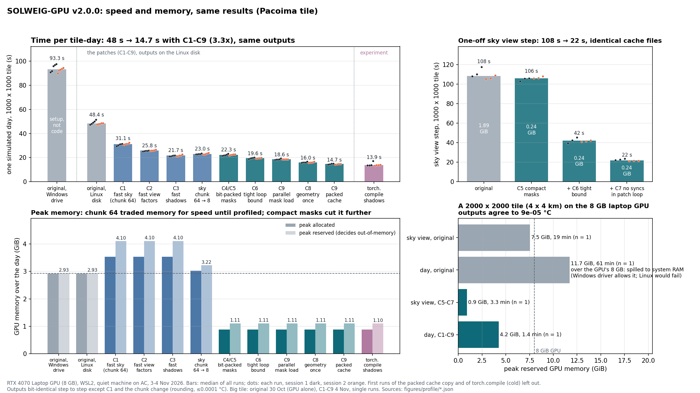

SOLWEIG-GPU v2.0.0 before and after C1-C9, on a 1000 x 1000 tile (Pacoima, 2 x 2 km at 2 m).

**a** Time for one simulated day after each change. The first bar is the original code writing its outputs to the Windows drive from WSL. Moving them to the Linux disk is a setup change, not a code change. From the original on the Linux disk to C1-C9 the day goes from 48.4 s to 14.7 s (3.3x). The last bar compiles the shadow loop with torch.compile. It is an experiment and not part of C1-C9.
**b** The sky view factor step, run once per tile: 108 s to 22 s, with identical cache files. The numbers inside the bars are peak reserved GPU memory.
**c** Peak GPU memory over the day. Reserved memory is what decides out-of-memory. The dashed line is the original. C1 with sky chunks of 64 needed more memory than the original. Going to chunks of 8 costs about 1 s and frees 0.9 GiB, and the bit-packed masks (C4/C5) bring the peak down to 1.1 GiB.
**d** A 2000 x 2000 tile (4 x 4 km) on the same 8 GB GPU, one run each. The original day needs 11.7 GiB. It only finished because the Windows driver spills GPU memory to system RAM, and took 61 min; on a native Linux driver it would run out of memory. With C1-C9 the day needs 4.2 GiB and 1.4 min, and UTCI and Tmrt agree with the original to 9e-5 °C.

Timing: two sessions (3 and 4 Nov 2026), quiet machine on AC power, 5 runs per day bar and 3 per sky view bar in each session. Bars are the median of all runs, dots are single runs. The first run of the packed cache (C9, writes the cache) and of torch.compile (compiles) are left out. Outputs are bit-identical from step to step, except C1 and the chunk change, which round differently by at most 0.0001 °C. The big tile runs are single runs: the original on 30 Oct with nothing else on the GPU, C1-C9 on 4 Nov.

Data: `figures/profile/bench_steps.json`, `bench_steps_b.json` (`scripts/bench_steps.py`), `bigtile_demo.json`, `bigtile_compare_current.json` (`scripts/bigtile_demo.py`). Script: `scripts/plot_summary.py`, which also saves each panel on its own (`summary_time.png`, `summary_svf.png`, `summary_memory.png`, `summary_bigtile.png`).

### figures/profile/bounds.png

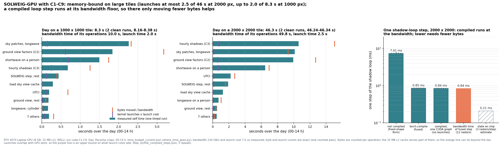

Where the time goes with C1-C9, and how far each part is from its floor.

**a, b** Time per function over 00-14 h on Pacoima crops of 1000 x 1000 and 2000 x 2000 px. Bars are measured self time, median of 5 runs, dots are the single runs. Orange: the bytes the function's operations read and write, divided by the measured bandwidth (227 GB/s). Purple: its kernel launches times the measured cost of one launch (7.0 µs). A function close to its orange line is memory-bound, and only moving fewer bytes makes it faster. Bytes are counted per operation, and the L2 cache serves some reuse, so the orange line can lie past the bar. Launches overlap with GPU work, so the purple line is the most that CUDA graphs could save. Summed over the day that is 2.5 of 48.4 s at 2000 px, but up to 2.0 of 8.4 s at 1000 px. The day totals come from 6 runs without the per-function timing (8.30-8.61 s and 47.95-49.11 s).
**c** One step of the hourly shadow loop at 2000 x 2000 px, 5 repeats. Not compiled (rewritten with fixed shapes so it can be compiled): 7.41 ms. Compiled with torch.compile: 0.85 ms. The compiled step captured as one CUDA graph, so with no launch cost: 0.84 ms. Reading and writing the step's 12 rasters once at full bandwidth: 0.85 ms. So the compiled step already runs at its bandwidth floor. The hatched bar is an estimate of something not built: a kernel that keeps the loop state on chip and reads only the three shifted inputs per step (0.21 ms).

Data: `figures/time_budget_current_r5.json` (`scripts/where_time_goes.py --repeats 5`), `figures/profile_compiled_steps.json` (`scripts/profile_compiled_steps.py`); the plotted numbers are in `figures/profile/bounds.json`. Script: `scripts/plot_bounds.py`, which also saves `bounds_day.png` (a, b) and `bounds_step.png` (c).

## Forecast ensembles

### figures/la_level_vs_pattern.png

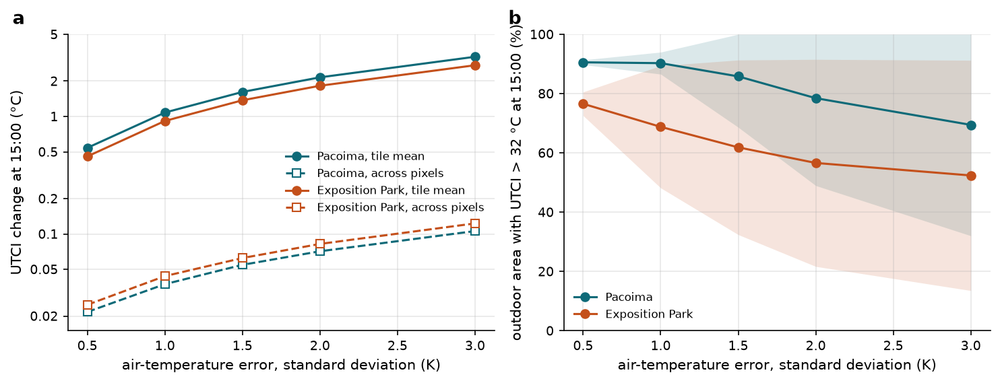

An air-temperature forecast error moves the level of a street-scale UTCI map, not its pattern.

Perfect-model ensembles on two 2 x 2 km tiles at 2 m, 30 July 2019: Pacoima (ground heating fitted to the measured surface temperatures, heat kept after sunset) and the Exposition Park venue tile (SOLWEIG's own ground model). 20 members per error size. The air-temperature error is AR(1) in time (lag-1 correlation 0.9) and has one value per hour for the whole tile, since SOLWEIG takes one air temperature per tile.

**a** Each member's UTCI change at 15:00 against the unperturbed run, split into the change of the tile mean (solid) and the standard deviation of the change across outdoor pixels (dashed), both averaged over members. Log scale. The tile mean moves by about 1.1 times the error standard deviation at Pacoima and 0.9 times at the venue. The part that differs between pixels is 3-5.5% of that. Each member's map keeps the ranking of the unperturbed map (Spearman correlation at least 0.999).
**b** Share of outdoor area with UTCI above 32 °C at 15:00, mean over members, band ±1 standard deviation (clipped at 0 and 100%). At an error of 1.5 K the area varies by 17 points between members at Pacoima and by 30 at the venue. The mean falls as the error grows, so a cold error takes away more area than an equally large warm error adds, which is what you expect when most outdoor area is already above 32 °C.

For scale: HRRR 2 m temperature errors over the western US in summer are about 1.5 K at analysis time and 2-2.7 K at 9-24 h lead (James et al. 2022, Wea. Forecasting 37, fig. 10c). The errors here are the same everywhere in the tile by construction, so part of the result is built in. spatial_error_fss.png tests errors that vary in space.

Data: `figures/la_forecast_error.json`, `figures/expo/la_forecast_error.json` (`scripts/run_la_forecast_error.py`, `scripts/analyse_la_forecast_error.py`). Script: `scripts/plot_level_pattern.py`.

### figures/shortcuts/shortcuts_vs_noise.png

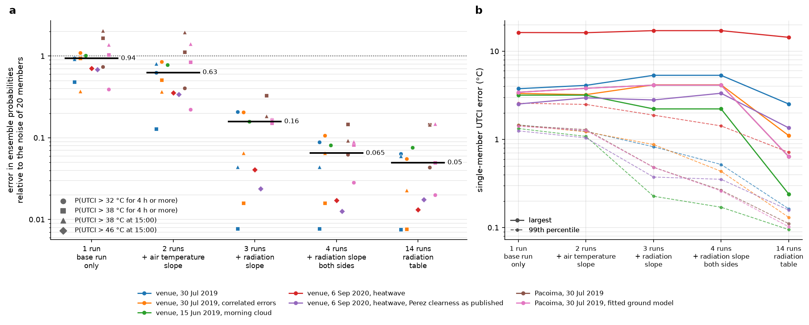

How few physics runs a 20-member ensemble needs.

In each setting, 20 members carry errors in air temperature (1.5 K), wind (30%) and global radiation (10%), AR(1) in time (lag-1 correlation 0.9), and are run with full physics. The shortcuts build the same 20 members from a few physics runs:

- 1 run: the unperturbed Tmrt, with each member's air temperature, humidity and wind in UTCI
- 2 runs: + the change in Tmrt per K of air temperature, per pixel and hour
- 3 runs: + the change per 10% of radiation
- 4 runs: + the same for radiation 10% low, so up and down have their own slope
- 14 runs: + a table of Tmrt at 13 radiation scales per hour (0.7 to 1.3)

**a** Mean absolute error of the shortcut's event probabilities against full physics, divided by the same measure between two independent 20-member full-physics ensembles. That second number is the sampling noise of the ensemble itself, so 1 means the shortcut is as far off as a second ensemble would be. One point per setting and probability; probabilities that are 0 or 1 everywhere on a day are left out. Black bars are medians: 0.94, 0.63, 0.16, 0.065, 0.05. With one radiation slope the shortcut error is under 1% to 33% of the noise.
**b** Single-member UTCI error against full physics: the largest over all members, outdoor pixels and hours, and the 99th percentile over pixels and hours, averaged over members. With one radiation slope the 99th percentile is below 0.9 °C, while the largest errors stay at 2-5 °C in a few pixels. The heatwave day with SOLWEIG's Perez clearness expression as coded has errors of 14-17 °C for every shortcut. With the expression as published they drop to 1.4-3.3 °C (see the next figure). On the other three days run both ways (venue 15 Jun and 30 Jul, Pacoima 30 Jul) the published form changes the scores of the shortcuts with radiation runs by 0.02 of the noise or less, and of the air-temperature-only ones by up to 0.14 (`shortcut_suite_*_perez_published.json`). It matters on the low-sun heatwave morning.

Settings: venue tile on 30 Jul 2019 (also with radiation errors correlated with the air-temperature errors), 15 Jun 2019 (morning cloud) and 6 Sep 2020 (heatwave); Pacoima on 30 Jul 2019, with SOLWEIG's own ground model and with the fitted one. All with C1-C9.

Data: `figures/shortcuts/shortcut_suite_*.json` (`scripts/shortcut_suite.py`), medians in `shortcuts_vs_noise.json`. Script: `scripts/plot_shortcuts.py`.

### figures/radiation_sweep_expo_compare.png

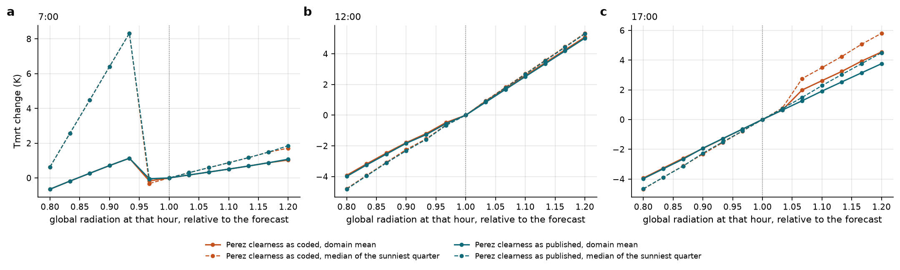

Tmrt against an error in global radiation at one hour, and what looks like a typo in the Perez sky clearness, carried over from UMEP.

Venue tile, 30 July 2019, SOLWEIG's own ground model. In each run, global radiation at 07:00, 12:00 and 17:00 is scaled by the same factor (an error at one hour hardly carries into later hours); 13 factors from 0.8 to 1.2. Solid: tile mean. Dashed: median over the quarter of outdoor pixels with the highest Tmrt in the unperturbed run, which at these hours are the sunlit ones.

Orange is the Perez sky clearness as coded in SOLWEIG-GPU and UMEP, ((Idh + Ibn)/(Idh + 1.041 z³))/(1 + 1.041 z³). Teal is the published definition (Perez et al. 1990, as pvlib implements it; checked against pvlib, not the paper itself), ((Idh + Ibn)/Idh + 1.041 z³)/(1 + 1.041 z³), with z the solar zenith angle in radians.

**a** At 07:00 both forms jump when radiation is 3-7% below the forecast. That jump comes from the direct/diffuse split's break at clearness index 0.78, not from the Perez expression.
**b** At 12:00 Tmrt is close to linear in the radiation error, with a mild kink at the forecast value where SOLWEIG caps its clearness indices.
**c** At 17:00 the coded form jumps when radiation is 3-7% above the forecast, about 1.3 K more in the sunlit quarter than the published form. The coded clearness crosses the boundary of the first Perez category (1.065) where the published one does not. On the heatwave day the same switch moves Tmrt at 08:00 by 4.6 K on average and up to 28.6 K in single pixels.

Data: `figures/radiation_sweep_expo.json`, `figures/radiation_sweep_expo_perez_published.json`. Script: `scripts/radiation_sweep.py --compare expo`.

## Sensitivity

### figures/la_sobol_day.png

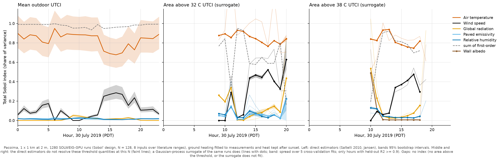

Which inputs drive heat stress at Pacoima through the day.

1280 runs (Sobol' design, N = 128, 8 inputs) on the central 1 x 1 km of Pacoima at 2 m, 30 July 2019, with ground heating fitted to the measured surface temperatures and heat kept after sunset (time constant 4 h). Inputs, uniform over: air temperature ±2.5 K, relative humidity ±6 points, wind x 0.3-1.0 (the station wind reduced to street level), global radiation x 0.9-1.1, paved emissivity 0.90-0.98, wall albedo 0.10-0.50, wall emissivity 0.85-0.95, paved albedo 0.06-0.08. The indices depend on these ranges; where each comes from is in `scripts/run_la_ensemble.py`.

**a** Mean outdoor UTCI. Total indices from the direct estimators (Jansen; first order Saltelli 2010), bands are 95% bootstrap intervals. A band can go above 1 through sampling error; the index itself cannot. Wind is exactly 0 at 06:00, 09:00 and 10:00, here and in b and c: the station reports calm (0.1 m/s) then, and SOLWEIG-GPU raises wind below 0.15 m/s to 0.15 before computing UTCI, so scaling it changes nothing.
**b, c** Share of outdoor area with UTCI above 32 and 38 °C. The direct estimators do not resolve these at N = 128, so the indices come from a Gaussian-process surrogate of the same runs (band: spread over its 5 cross-validation fits). They are drawn only at hours where the surrogate predicts held-out runs with R² of 0.9 or more. Gaps are hours with no area above the threshold, or 38 °C at 19:00, where R² is 0.85.

Each panel draws the three inputs with the largest total index averaged over the day. Dashed: the sum of first-order indices; 1 means the inputs act additively, and the gap below 1 is interactions (mostly air temperature with wind). The other inputs average below 0.1, but humidity and paved emissivity reach 0.22-0.23 for the 32 °C area at 20:00, and wall albedo reaches 0.49 for the 38 °C area at 10:00, when little area is above 38 °C.

The surrogate's indices match the direct estimators on 3840 runs it was not fitted to (la_sobol_surrogate_check.png). The figure keeps the surrogate because the direct estimates, even on all 5120 runs, are too wide to read for the 32 °C area at the hours where it varies only 3-10 points between runs: the air-temperature index spans 0.60-1.56 at 11:00 and 0.43-1.25 at 14:00 (95%), and the first-order sum jumps between 0.20 and 1.02 from hour to hour. They agree with the surrogate within those intervals; the direct version is la_sobol_day_n512.png. The bands here are the spread over the surrogate's 5 cross-validation fits, not a full uncertainty. The interaction holds on the direct estimates too: from 14:00 to 18:00 the total indices of both areas add up to 1.2-1.5 and the first-order ones to less than 1, on all 5120 runs and on the 3840 alone, while mean UTCI adds up to 1.00. Its exact size is not resolved.

Data: `figures/la_sobol.json`, `figures/la_sobol_surrogate_allhours.json` (`scripts/run_la_sobol.py`, `scripts/sobol_surrogate.py --all-hours`). Script: `scripts/analyse_la_sobol.py`.

### figures/la_sobol_surrogate_check.png

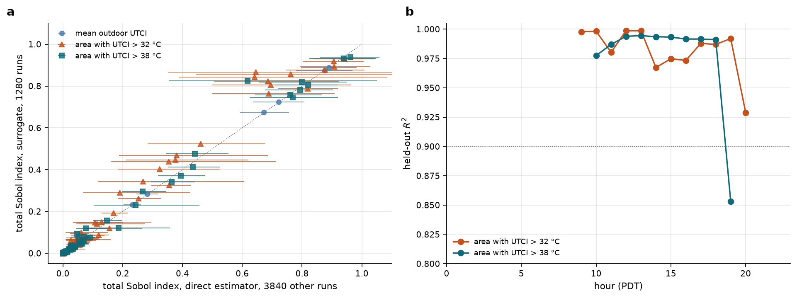

Check of the surrogate behind la_sobol_day.png. A Gaussian process (Matérn 5/2, one length scale per input) is fitted to the 1280 runs, and its indices come from a Saltelli design of 8192 base samples on its mean. The design was later grown to N = 512 (5120 runs, the first 1280 being the pilot's), so the surrogate can be checked against the direct estimators on the 3840 runs it was not fitted to.

**a** Total index from the surrogate against the direct estimator on those 3840 runs, for every input, at every hour where the quantity varies between runs (the areas: standard deviation of at least 1 point) and the surrogate predicts held-out runs with R² of 0.9 or more. Bars: 95% bootstrap intervals of the direct estimate. Dotted: equal. 169 of 184 surrogate indices fall inside the interval (mean UTCI 31 of 32, area above 32 °C 83 of 88, above 38 °C 55 of 64). Of the 15 outside, 9 are inputs with no effect at that hour, where both are 0.00 and the interval has no width; the other 6 differ by 0.04 or less. Median differences: 0.000, 0.004 and 0.005. For mean UTCI the two agree far closer than the intervals suggest: the runs follow a quasi-random Sobol' sequence, which converges much faster than random sampling for a smooth quantity, while the bootstrap treats the runs as random. The threshold areas are not smooth, so there the agreement is looser.
**b** R² on held-out runs (5-fold cross-validation) at each hour where the area varies between runs. Dotted: 0.9, below which la_sobol_day.png leaves a gap.

Data: `figures/la_sobol_surrogate.json`, `figures/la_sobol_surrogate_allhours.json`, `figures/la_sobol_n512_new.json` (`scripts/run_la_sobol.py extend --n 512`, `scripts/analyse_la_sobol.py --n 512 --skip-base 128 --tag _n512_new --json-only`). Script: `scripts/sobol_surrogate.py --check-figure figures`.

### figures/hrrr/hrrr_errors.png

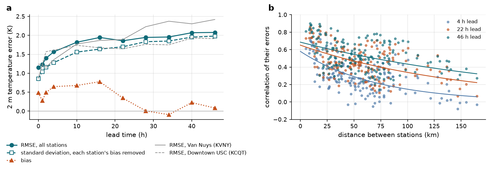

How large HRRR's 2 m temperature errors are around our tiles, and how far they reach. 19 airport stations in and around the Los Angeles basin, summers (June to September) 2021-2023, HRRR v4 forecasts valid at 15:00 PDT, value at the grid point nearest each station (no height correction). 4025 forecasts.

**a** Error against lead time. RMSE over all stations goes from 1.15 K at analysis time to 1.6 K at 4 h, 1.8-1.9 K at 10-22 h and 2.1 K at 40-46 h, with a warm bias of up to 0.8 K at short leads. Grey lines: the two stations next to our tiles (Van Nuys for Pacoima, Downtown USC for the venue).
**b** Correlation between the errors of two stations against their distance, each station's own mean bias removed first, with an exponential fit. A day ahead about two thirds of the error variance is shared over 100 km and more, which is the same over a 2 km tile; the rest is not shared even by stations 5-15 km apart. That local part is about 1 K at every lead. Part of it is where each station sits, not air temperature that varies between streets.

Data: `figures/hrrr/hrrr_points.csv`, `hrrr_errors.json`. Script: `scripts/hrrr_errors.py`.

### figures/street_ta/street_ta.png

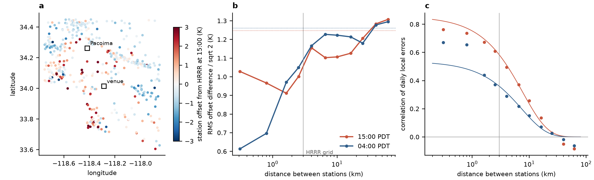

Air temperature below HRRR's 3 km grid, from every public station in the basin. All stations with air temperature in the MADIS public archive in an 80 x 90 km box (MesoWest networks, citizen stations of the CWOP network, fire-weather stations), summers 2021-2023 at 15:00 and 04:00 PDT, against HRRR's 1 h forecast at the same place and hour (bilinear on the 3 km grid; moved to the station's height with -6.5 K/km at 15:00, not at 04:00, where night inversions make that correction wrong). After quality control 415 stations and about 125,000 reports per hour. The difference station minus HRRR is split into a basin-wide part per time, a lasting offset per station and a daily local part. Their sizes: 0.41, 1.25 and 1.00 K at 15:00; 0.34, 1.26 and 1.29 K at 04:00.

**a** Lasting offset per station at 15:00. Citizen stations run 1.6 K warmer than the MesoWest ones by day and the same at night: sun on the sensor or warm siting. So part of the daytime offsets is how stations are sited.
**b** How different the offsets of two stations are against their distance (square root of the semivariance; dotted: the value for unrelated stations). By day two stations 300 m apart differ about as much as two 2.5 km apart: the variation sits at the scale of the station's site. At night it builds up between 0.3 and 4 km, inside one HRRR grid cell. Land cover around the stations (ESA WorldCover 10 m within 100 and 500 m, distance to the ocean, heights) explains 4-12% of the daytime offsets and 14-32% of the night ones, with 5 km blocks of stations held out.
**c** Correlation of the daily local parts of two stations against their distance, with an exponential fit: about 8 km at both hours, so inside a 2 km tile the daily local error is mostly the same everywhere. The fit overshoots the closest pairs (0.76 measured at 0.3 km by day, 26 pairs).

Stations are not in streets, and fewer than 30 pairs are closer than 500 m: nothing here resolves street scale. Data: `figures/street_ta/street_ta.json` (with no height correction: `street_ta_nolapse.json`). The per-station table (`stations.csv`) is written locally and kept out of git, since citizen stations are mostly at private homes. Script: `scripts/street_ta_structure.py`.

### figures/street_ta/street_ta_baseline.png

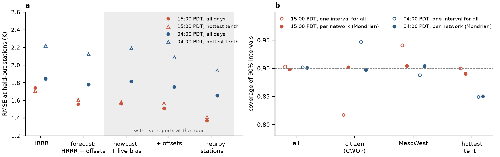

A first air-temperature layer on top of HRRR, scored on stations it never saw (5 km blocks held out in turn, 402-404 stations, same data as street_ta.png).

**a** RMSE at the held-out stations. Forecast (no reports at the valid time): HRRR plus each station's offset predicted from its surroundings and the mean bias, both learned beforehand. Nowcast (shaded, with live reports from the other stations at that hour): plus the basin-wide error at that hour, the learned offsets, and the local error interpolated from nearby stations (simple kriging with the fitted correlation). By day the error goes from 1.74 to 1.56 K (forecast) and 1.37 K (nowcast); at night from 1.85 to 1.78 and 1.66 K. Triangles: the hottest tenth of days or nights, where night errors are largest.
**b** Coverage of conformal 90% intervals for the nowcast layer, calibrated on the training stations' own held-out errors. Overall 0.90. One interval for all stations covers citizen stations by day only 82% of the time and MesoWest stations 94%; calibrated per network (Mondrian) both reach 0.90. On the hottest tenth of nights coverage stays at 0.84-0.85 either way: the calibration from ordinary nights does not carry over to the hottest ones.

Data: `figures/street_ta/street_ta_baseline.json` (no height correction: `street_ta_baseline_nolapse.json`). Script: `scripts/street_ta_structure.py`.

### figures/spatial_error/spatial_error_fss.png

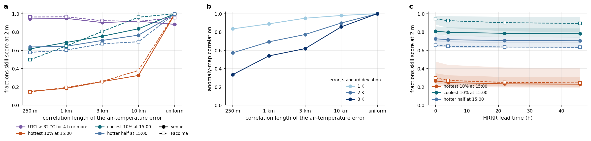

The same skill test as la_level_vs_pattern.png, with air-temperature errors that vary in space. SOLWEIG takes one air temperature per tile, so the error is applied pixel by pixel with the shortcut from the shortcut suite: each pixel's Tmrt changes by its own slope with air temperature (from a run with air temperature + 1 K), and UTCI follows from the local air temperature. That shortcut was within 0.01 °C of full physics. 20 members, errors AR(1) in time (lag-1 correlation 0.9) and exponentially correlated in space. Venue tile (own ground) and Pacoima (fitted ground), 30 July 2019.

**a** Fractions skill score at 2 m (single forecast) against the error's correlation length, at an error of 2 K. Solid: venue, dashed: Pacoima. With a uniform error every event scores near 1. Once the error varies in space, the hottest 10% at 15:00 drops to 0.15-0.4: the top of the map is flat, so which sunlit pixels are hottest is decided by tenths of a degree. The coolest 10% (shade) and the hotter half keep 0.5-0.96. UTCI above 32 °C for 4 h stays at 0.90-0.97, about as with a uniform error, since local errors partly cancel over the tile.
**b** Correlation between members' UTCI maps at 15:00 with the tile mean removed, venue: 0.33-0.98 depending on size and length.
**c** With errors like HRRR's (from hrrr_errors.png): at each lead the measured size, a share uniform over the tile and the rest local. Line: local length 1 km; band: 250 m to 3 km, since stations cannot tell which. The scores hardly change from analysis to 46 h. The local part of the error is about 1 K at every lead, and that is what limits the pattern; lead time adds to the uniform part, which only moves the level.

Data: `figures/spatial_error/*.json`. Scripts: `scripts/spatial_error_fss.py`, `scripts/plot_spatial_error.py`.

### figures/forecast_demo/forecast_demo.png

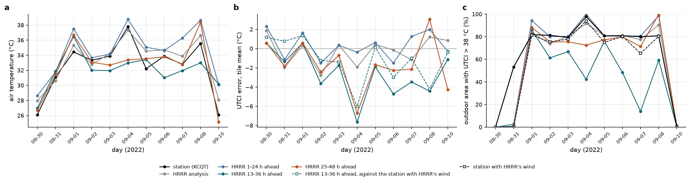

A street-scale UTCI forecast driven by real HRRR forecasts: the venue tile during the late August - September 2022 Los Angeles heatwave, 11 days (9 September left out, the station had 16 of 24 hours). SOLWEIG forced by HRRR at the tile centre (2 m temperature and humidity, 10 m wind, radiation, pressure) from the run of 06 UTC on the day (1-24 h ahead), 18 UTC the day before (13-36 h) and 06 UTC the day before (25-48 h). Reference: the same model forced by the Downtown USC station (air temperature, humidity, wind) with the HRRR analysis' radiation, so radiation enters the same way.

**a** Air temperature at 15:00. The day-ahead runs miss the peaks: 33.0 °C forecast on 4 September against 37.8 °C measured.
**b** Error of the tile-mean UTCI at 15:00 against the station-forced run. Same-day forecast: 1.2 °C on average; 13-36 h ahead: 2.8 °C, too cool by 2.6 °C on average and by 7.6 °C on 4 September. Even the analysis is off by about 1.2 °C, mostly through wind: HRRR's 10 m wind is 2-6 m/s above the station's on most days, and more wind means lower UTCI. Dashed: the 13-36 h forecast against the station's air temperature and humidity with HRRR's wind. Its error drops to 1.9 °C, too cool by 1.3 °C, so about half of the day-ahead miss is the sheltered station's wind against the model's 10 m wind, and the rest is the missed heat peaks (still 6 °C on 4 September).
**c** Share of outdoor area with UTCI above 38 °C at 15:00. On 4 September the station-forced run has 98% of the area above 38 °C, the 13-36 h forecast 43%. Dashed: the station with HRRR's wind.

The forcing is one value per tile, so this says nothing about the pattern; spatial_error_fss.png does. 11 days at one site.

Data: `figures/forecast_demo/hrrr_point.csv`, `forecast_demo.json`. Script: `scripts/forecast_demo.py`.

## Supplementary

### figures/la_sobol_day_n512.png

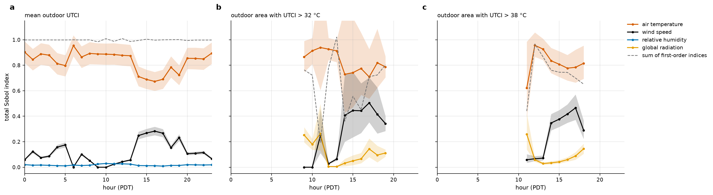

la_sobol_day.png from the direct estimators on all 5120 runs (N = 512) in every panel, instead of the surrogate for the areas; same inputs, ranges and runs. Bands: 95% bootstrap intervals. Gaps: hours where the area varies less than 1 point between runs. Mean UTCI (a) and the 38 °C area (c) look much as in the main figure. The 32 °C area (b) is readable at 9-10, 12-13 and 17-19 h but not at 11 and 14-16 h, where the air-temperature interval spans 0.4-1.6. Data: `figures/la_sobol_n512.json`. Script: `scripts/analyse_la_sobol.py --n 512 --tag _n512 --no-maps --direct --day-out figures/la_sobol_day_n512.png`.

### figures/la_forecast_error_fss.png and figures/expo/la_forecast_error_fss.png

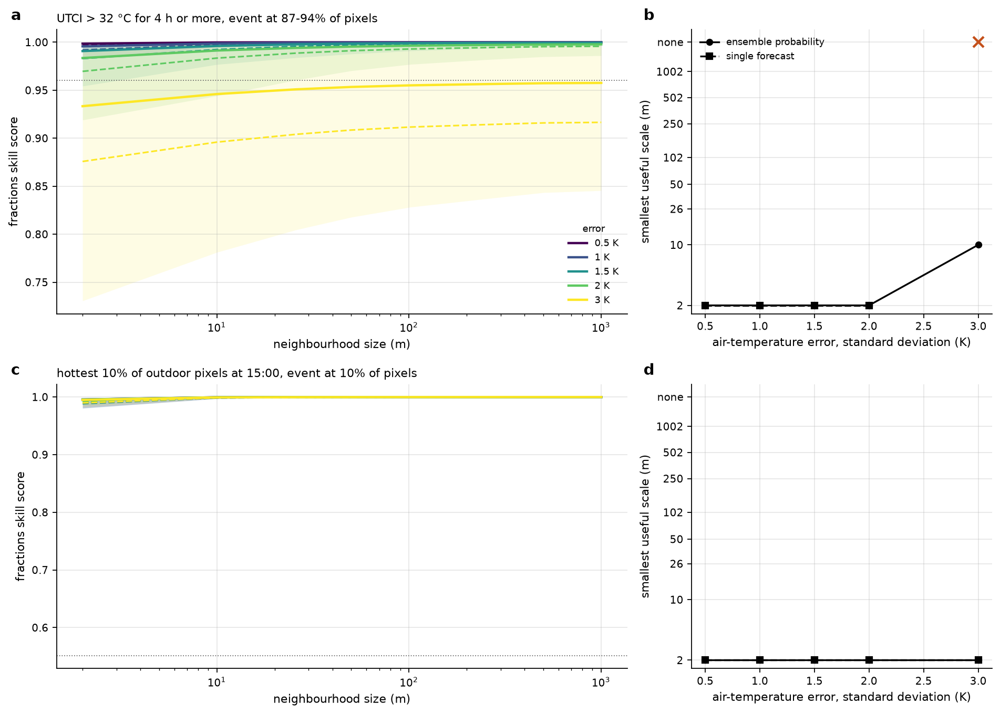

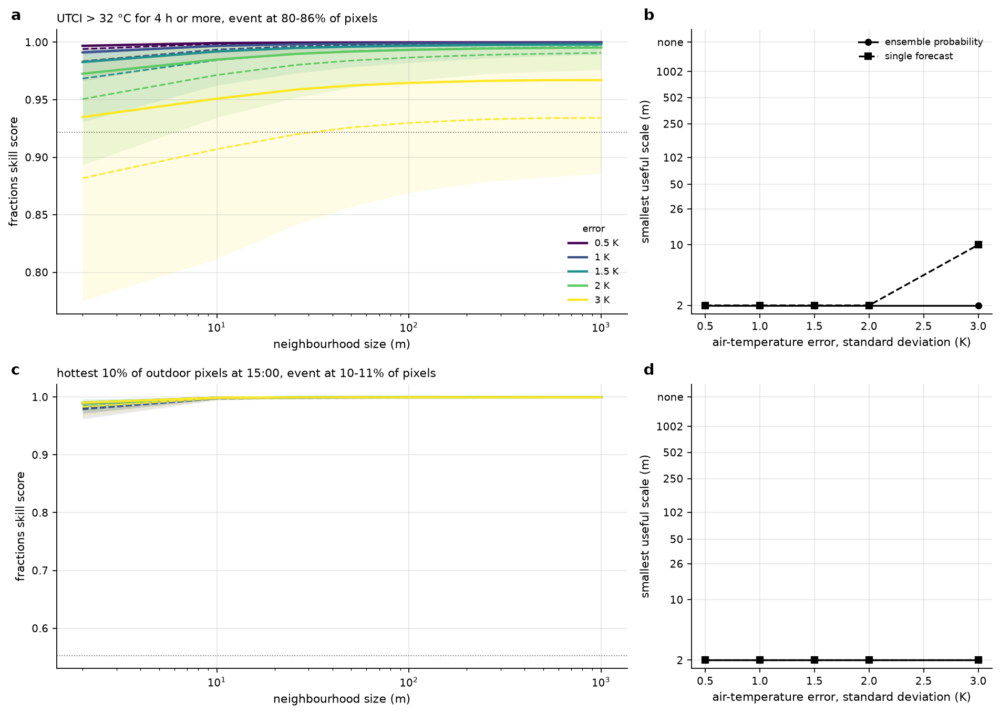

Fractions skill score (Roberts and Lean 2008) of the ensembles in la_level_vs_pattern.png, Pacoima first, then the venue. Each member in turn is the truth and the others are the forecast.

**a** Event: UTCI above 32 °C for 4 h or more. Most pixels reach it, so this score mostly measures the level of the map. Solid: the probability from the other 19 members. Dashed: one other member, as a single forecast. Lines are the mean over truths, bands the 10th to 90th percentile of the single forecast. Dotted: useful skill, FSS = 0.5 + f/2 with f the event frequency.
**c** Event: each map's own hottest 10% of outdoor pixels at 15:00. This removes the level and asks only whether the hot spots are in the right streets. With an error that is the same over the whole tile that is nearly built in, and the top of the UTCI map is flat (41% of the venue's outdoor pixels lie within 0.5 °C of the 90th percentile), so with errors that vary in space this event falls apart: see spatial_error_fss.png.
**b, d** The smallest neighbourhood at which the forecast is useful. The tested neighbourhoods are odd numbers of 2 m pixels (1, 5, 13 ... 501), hence 2, 10, 26 ... 1002 m. 2 m means useful at the single pixel. "none" (x) means not useful at any scale tested, up to 1 km.

UTCI above 38 °C for 4 h or more is too rare on this day to score; it is in the JSON. Same data as la_level_vs_pattern.png. Script: `scripts/analyse_la_forecast_error.py` (`--replot` redraws from the JSON).

## Other figures

The other figures in `figures/` still carry their own titles and notes and have no entry here yet: the earlier sensitivity work (one-at-a-time, Morris, emulator, Los Angeles against measurements), the Sobol maps (`la_sobol_maps_16h.png`), the single radiation sweeps (`radiation_sweep_expo.png` and its published-Perez version) and the memory and chunk plots in `figures/profile/`.
