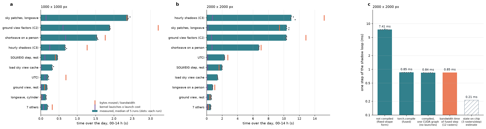

# Performance log

What each change did to run time and GPU memory, starting from SOLWEIG-GPU v2.0.0. What the changes are and how they were checked is in `SOLWEIG_MODIFICATIONS.md`. Captions for the figures are in `FIGURES.md`.

## How it was measured

- One simulated day (24 h) on a 1000 x 1000 tile at 2 m (Pacoima, 30 July 2019), sky view factor cached, UTCI and Tmrt saved, unless stated.
- RTX 4070 Laptop GPU (8 GB), WSL2 Ubuntu, PyTorch 2.5.1 / CUDA 12.1, nothing else on the GPU (checked from inside WSL, since Windows `nvidia-smi` cannot see WSL processes), laptop on AC power.
- Time is wall time of `run_utci_tiles`. Memory is PyTorch's peak allocated (live tensors) and peak reserved (what the caching allocator holds; this decides out-of-memory).
- Up to 30 Oct most numbers are single runs, and repeated runs differ by about ±2 s. From 3 Nov every step is repeated (next section).

## Every step, 3-4 Nov

`scripts/bench_steps.py`: each step timed 5 times per session (the sky view step 3 times), in a shuffled order each round, two sessions on a quiet machine (`figures/profile/bench_steps.json`, `bench_steps_b.json`). The first run of the packed cache copy (it writes the copy) and of torch.compile (it compiles) is left out. The table gives the median of each session; the two agree within 4% everywhere, 5% for the C7 sky view step. Figure: `figures/profile/summary.png`.

| Step | Change | Day, session 1 / 2 | Peak reserved | Output vs step before |
|---|---|---:|---:|---|
| A | original, outputs on the Windows drive | 95.9 / 92.9 s | 2.93 GiB | reference |
| B | original, Linux disk | 49.0 / 48.2 | 2.93 | bit-identical |
| C | + C1 fast sky (chunks of 64) | 31.1 / 31.3 | 4.10 | within 0.0001 °C |
| D | + C2 ground view factors | 25.7 / 26.0 | 4.10 | bit-identical |
| E | + C3 hourly shadows | 21.6 / 21.8 | 4.10 | bit-identical |
| E8 | sky chunks of 64 to 8 | 23.0 / 23.1 | 3.22 | within 0.0001 °C |
| F | + C4/C5 bit-packed masks | 22.0 / 22.5 | 1.11 | bit-identical |
| G | + C6 tight loop bound | 19.6 / 19.6 | 1.11 | bit-identical |
| G2 | + C9 parallel mask loading | 18.4 / 18.6 | 1.11 | bit-identical |
| H | + C8 geometry once per run | 16.0 / 16.1 | 1.11 | bit-identical |
| I | + C9 packed cache copy | 14.7 / 14.7 | 1.11 | bit-identical |
| J | + torch.compile of the shadow step (experiment, not in C1-C9) | 13.7 / 13.9 | 1.10 | bit-identical |

From the original on the Linux disk to C1-C9: 48.4 to 14.7 s per tile-day (3.3x) and 2.93 to 1.11 GiB reserved.

Sky view step (once per tile, 1000 x 1000): original 109.9 / 105.9 s (1.89 GiB), C5 compact masks 105.5 / 106.2 s (0.24 GiB), + C6 42.6 / 41.6 s, + C7 22.7 / 21.5 s. The cache files are byte-identical to the original's at every step (2 files and 15 zip members).

Sky chunk size with the current code (`figures/profile/bench_chunks.json`, 5 runs each, `chunk_tradeoff.png`):

| Patches per chunk | 8 | 16 | 32 | 64 | 153 |
|---|---:|---:|---:|---:|---:|
| Day | 14.5 s | 14.2 s | 13.9 s | 13.8 s | 13.6 s |
| Peak reserved | 1.11 GiB | 1.39 | 1.58 | 2.60 | 4.88 |

The default stays at 8: bigger chunks save under a second for up to 4.4 times the memory.

## 2000 x 2000 tile, 4 Nov

`scripts/bigtile_demo.py --current` and `--steps`, `figures/profile/bigtile_demo.json`, single runs, nothing else on the GPU:

| | Original (30 Oct) | C1-C9 (4 Nov) |
|---|---|---|
| Sky view step | 19 min, 7.52 GiB | 199 s, 0.89 GiB |
| One day | 61 min, 11.68 GiB (spilled to system RAM) | 81 s (98 s for the run that writes the packed copy), 4.23 GiB |

UTCI and Tmrt agree with the original within 9.2e-5 °C, nowhere above 0.01 °C (`bigtile_compare_current.json`). Step by step on this tile: F 111 s, G 95 s, G2 94 s, H 93 s, I 82 s, all at 4.23 GiB reserved, so nothing after C4/C5 adds memory. (The 30 Oct run of the C4/C5 code measured 3.79 GiB while another job shared the GPU; alone it measures 4.27 GiB.)

The 61 min of the original is not a speed comparison. The original day needs 11.7 GiB on an 8 GB card. It only finished because the NVIDIA Windows driver that WSL uses moves GPU memory to system RAM when the card is full, which is very slow. On a Linux cluster there is no such fallback and it would stop with out-of-memory. The original sky view step (7.5 GiB) just fits an empty 8 GB card. On a GPU big enough for the original, expect a speed-up of the same order as on the 1000 x 1000 tile; it has not been measured.

## Where the time goes, and the floors (4-5 Nov)

`scripts/plot_bounds.py` from `figures/time_budget_current_r5.json` (`where_time_goes.py --repeats 5`, C1-C9, 00-14 h) and `figures/profile_compiled_steps.json`. For each function: measured self time, the bytes its operations move divided by the measured bandwidth (227 GB/s), and its kernel launches times the measured cost of one launch (7.0 µs).

- Day, 1000 x 1000: 8.4 s measured (6 runs without the per-function timing, 8.30-8.61 s), bandwidth time of its operations 10.1 s, launch time 2.0 s. Day, 2000 x 2000: 48.4 s (47.95-49.11 s), 50.5 s, 2.5 s. Self times are the median of 5 timed passes per size (5 Nov, quiet machine). The single pass of the night of 3-4 Nov (`time_budget_current.json`) gave 8.3 and 46.3 s.
- Every large function is at 0.6-1.1 times its bandwidth time (above 1 where the 32 MB L2 cache serves some reuse). So on the large tile C1-C9 is memory-bound, and launches add at most 2.5 of 48 s. At 1000 x 1000 they can add up to 2.0 of 8.4 s, mostly in the ground view factors and the shortwave on a person. That is an upper bound, since launches overlap with GPU work.
- Shadow step at 2000 x 2000 (5 repeats): not compiled 7.41 ms, torch.compile 0.855 ms, the compiled step captured as one CUDA graph 0.840 ms, bandwidth time of the fused step (12 rasters read or written once) 0.84 ms. So torch.compile already reaches the step's bandwidth floor.
- What could lower the floors (estimates, not built): keep each loop's per-pixel state on chip across steps, one kernel per hour that reads only the three shifted inputs per step. That is about 4 times less traffic, with the same operations in the same order per pixel, so still exact. Also unpacking the bit-packed masks inside the kernels that use them, and fusing the hourly radiation functions. Lower precision would halve the traffic but give up bit-identity.

## torch.compile and CUDA graphs (experiments, 2-4 Nov)

Neither is part of C1-C9, and both keep the outputs bit-identical. The hourly shadow step only subtracts, compares, takes maxima and adds whole numbers, so fusing it cannot round differently.

Compiling one step of the shadow loop with C3's slicing (`dynamic=True`) recompiled almost every hour, because the slice sizes change with the sun (10 graphs after 5 calls, 2-4 s each). Building the shifted rasters by index arithmetic, with the window passed as GPU data, gives one shape for every hour: 2 graphs in total and 4-8 times faster per call (`scripts/compile_shadow.py`, `figures/compile_shadow_1000_*.json`).

Measured on a quiet machine, 3-4 Nov:

| Experiment | 1000 x 1000 | 2000 x 2000 |
|---|---|---|
| torch.compile, hourly shadow step, whole day | -5 to -7% | 84.2 to 66.7 s (-21%) |
| torch.compile, sky-patch step, whole sky view step | 21.2 to 17.5 s (-17%) | about 200 to 95 s (-52%) |
| torch.compile, ground view step | no gain (1.01x per call) | -5% |
| CUDA graphs (torch.compile mode "reduce-overhead"), sky view step | 21.3 to 25.3 s (+19%, slower) | not run (bound below) |
| CUDA graphs, shadow step, whole day | -1.4% | -10% (plain compile: -21%) |
| Launch overhead of a compiled step (the most graphs can remove) | 2.1% shadow, 3.6% sky | 1.7% shadow, 0.5% sky |

- The first compilation on a machine with empty caches (inductor and Triton) costs about 3-4.5 s, once; the caches persist.
- The ground view step's temporaries carry over from step to step, so fusion cannot drop their traffic.
- Our CUDA-graph version copied about 5 rasters into and 5 out of the graph's fixed buffers per step, which made it slower. Even a perfect version is bounded by the launch overhead in the last row.
- Several tiles at once (`scripts/bench_concurrency.py`, 400 x 400 windows, C1-C9): 1, 2, 3, 4 and 6 jobs give 1.00, 1.57, 1.82, 1.96 and 2.14 times the throughput (with C1-C6 on 2 Nov: 1.00, 1.49, 1.64, 1.70, 1.58).

## Earlier measurements, 30 Oct

Single runs unless stated. They show the order things happened in and what the memory profile caught; the numbers above replace them.

Baseline, original code:

| | Value | Source |
|---|---|---|
| Time, outputs on the Windows drive (`/mnt/c`) | 103 s | `bench_fast_sky.py` |
| Time, outputs on the Linux file system | 45-47 s | `bench_fast_sky.py` |
| Peak allocated / reserved | 2.90 / 2.92 GiB | `profile_memory.py` |
| Memory held all day | 2.56 GiB, mostly three float32 sky-patch masks (3 x 612 MB) and a float32 `diffsh` (612 MB) | trace of 13:00 |
| Largest hourly transient | 0.30 GiB, ground view factors | per-component profile |
| Where the time went | 33% writing outputs to `/mnt/c`, 27% the sky patch loop, 21% view factors and shadows, 7% loading the sky view cache, under 1% UTCI | `profile_solweig.py` |
| Allocator events, hour 13:00 | 132,312 | trace |

Changes in the order they were made:

| Step | Change | Time | Peak allocated | Peak reserved | Output vs original |
|---|---|---:|---:|---:|---|
| 0 | Original, outputs on `/mnt/c` | 103 s | 2.90 GiB | 2.92 GiB | reference |
| 1 | Outputs on the Linux file system (A5) | 45-47 s | 2.90 | 2.92 | bit-identical |
| 2 | Fast sky, chunks of 64 (C1, first version) | 29-34 s | 3.52 | 4.08 | within 0.0001 °C |
| 3 | + C2 | 25-29 s | 3.52 | 4.08 | C2 bit-identical |
| 4 | + C3 | 21-25 s | 3.52 | 4.08 | C3 bit-identical |
| 5 | Sky chunks of 64 to 8 | 26-28 s | 3.00 | 3.21 | within 0.0001 °C |
| 6 | + C4 bit-packed masks | 23-24 s (two runs; original 50-66 s in the same session) | 0.80 | 0.99 | bit-identical to step 5 |
| 6a | `PackedMask` returns float32 slices instead of uint8 | same | 0.87 | 1.09 | bit-identical |
| 7 | + C5 compact masks in the sky view step | sky view 313 to 304 s | sky view 1.87 to 0.22 | sky view 1.89 to 0.24 | identical cache files |

Steps 2-4 traded memory for time without us noticing, and the memory profile at step 5 caught it. Step 6 then brought memory 3.3 times (allocated) and 2.7 times (reserved) below the original's, at no cost in time; step 6a gave back 0.07 GiB of that for safer types. One-hour allocator traces: `figures/profile/memory_trace_original.png`, `memory_trace_final.png` (side by side `memory_trace_compare.png`, series in `memory_trace_*.npz`, redrawn by `scripts/replot_traces.py`).

**Chunk size.** The fast sky turns the 153-patch loop into matrix-vector products over chunks of patches. For each chunk it builds temporaries of shape (rows, cols, chunk): boolean masks (1 byte per element), float32 copies of them and the sunlit and shaded angles (4 bytes each). Several are alive at once, so on a 1000 x 1000 tile they take about 0.1 GiB per 8 patches. The original held one patch at a time and its sky step added only 0.09 GiB. Reserved memory grows faster than allocated because blocks of varying size fragment PyTorch's cache. Time hardly changes with the chunk, because the gain came from removing the Python loop with its tens of thousands of small operations and syncs, and any chunk size does that: with chunks of 8 there are 20 chunks of about 20 operations per hour, a few hundred launches against about 58,000 before. On 30 Oct (chunks of 8, 16, 32, 64, 153, with C1-C3): 25.9, 26.5, 26.9, 24.5 and 23.7 s, and 3.21, 3.38, 3.45, 4.08 and 5.40 GiB reserved. Chunks of 64 had been chosen without measuring memory and were the default on the morning of 30 Oct, so `verify_fast.json` from that morning used them; outputs are the same to float32 rounding either way. A larger chunk is fine on a GPU with room to spare (`define_patch_characteristics(..., chunk=64)` or `fast_sky.CHUNK`), but memory scales with tile area, so the chunk matters more on large tiles.

**Compact masks** (`scripts/verify_compact.py`, `figures/profile/verify_compact.json`). The three sky-patch masks hold only 0 and 1 but were float32 (4 bytes per value, 153 values per pixel each), plus a float32 `diffsh` derived from them. Peak allocated / reserved and time per day with seven outputs saved:

| 1000 x 1000 (Pacoima; Austin within 0.01 GiB) | float32 masks | uint8 masks | bit masks |
|---|---|---|---|
| Original functions | 2.90 / 2.92 GiB, 55-57 s | 1.05 / 1.07 GiB, 54-55 s | 0.68 / 0.71 GiB, 53-56 s |
| C1-C3 | 3.00 / 3.22 GiB, 28-29 s | 1.15 / 1.36 GiB, 28-30 s | 0.80 / 0.99 GiB, 29 s |

| Pacoima as four tiles (largest 620 x 620) | float32 masks | uint8 masks | bit masks |
|---|---|---|---|
| Original functions | 1.11 / 1.14 GiB, 203 s | 0.40 / 0.43 GiB, 211 s | 0.26 / 0.28 GiB, 206 s |
| C1-C3 | 1.16 / 1.26 GiB, 61 s | 0.45 / 0.53 GiB, 67 s | 0.32 / 0.39 GiB, 57 s |

All 12 comparisons are bit-identical on all seven outputs. There is no time cost we can measure: unpacking a patch is a shift and a mask on a byte array, against hundreds of operations per patch in the hourly work. From two tile sizes, C1-C3 with bit masks need about 0.8 GiB allocated and 1.0 GiB reserved per million pixels, against 2.9 for the original.

**Compact masks in the sky view step** (`scripts/verify_compact_svf.py`, `figures/profile/verify_compact_svf.json`). `svf_calculator` allocates the three masks up front as float32 (`torch.zeros((rows, cols, 153))`) and fills them one patch at a time, so a 1000 x 1000 tile held 1.8 GB of masks while computing, although each patch's shadow is exactly 0 or 1. With C5 the peak goes from 1.87 / 1.89 GiB to 0.22 / 0.24 GiB (8.5 times less) at the same speed (313 and 304 s, single runs), and the cache files are identical, 19 of 19 arrays.

**2000 x 2000 on 30 Oct** (`figures/profile/bigtile_demo.json`, the C4/C5 runs shared the GPU with another job): sky view 19 min and 7.49 / 7.52 GiB for the original, 18 min and 0.87 / 0.89 GiB with C1-C5; one day 61 min and 11.56 / 11.68 GiB for the original, 1.9 min and 3.20 / 3.79 GiB with C1-C5. The outputs differed by at most 0.000084 °C in UTCI and 0.000092 °C in Tmrt over 78 and 96 million values (`bigtile_compare.json`).
